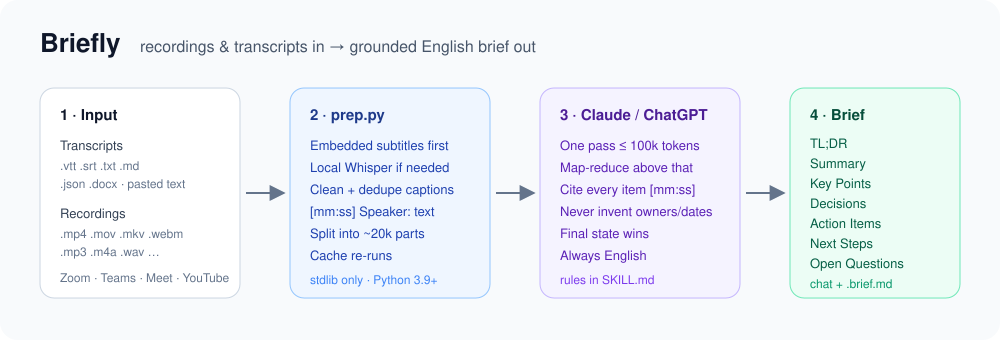
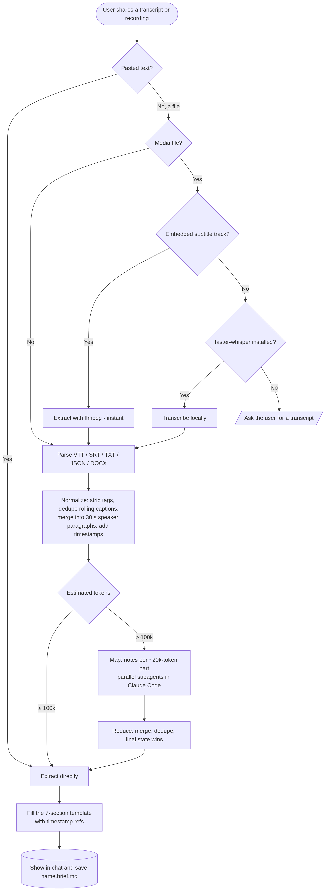

<div align="center">

# Briefly

**Turn meeting, lecture, podcast and interview recordings — or their transcripts — into a grounded, timestamped English brief.**

TL;DR · Summary · Key Points · Decisions · Action Items · Next Steps · Open Questions

[](LICENSE)




</div>

---

## Contents

- [Why Briefly](#why-briefly)
- [Features](#features)
- [Requirements](#requirements)
- [Installation](#installation)
- [Usage](#usage)
- [How it works](#how-it-works)
- [Output format](#output-format)
- [Supported inputs](#supported-inputs)
- [Script reference (`prep.py`)](#script-reference-preppy)
- [Project structure](#project-structure)
- [Testing and evaluation](#testing-and-evaluation)
- [Limitations and FAQ](#limitations-and-faq)
- [License](#license)

---

## Why Briefly

Meeting summarizers fail in predictable ways: they invent owners, turn "by Friday" into a wrong calendar date, report a decision that was reversed ten minutes later, or quietly skip the middle of a long recording. Briefly is built around avoiding exactly those failures:

- **Every item is grounded** — each bullet and action item cites the `[mm:ss]` timestamp where it was said.
- **Nothing is invented** — owners and due dates appear only when stated; otherwise `Unassigned` / `—`.
- **The final state wins** — if a decision is reversed or a task is completed later in the same recording, only the final state is reported.
- **Nothing is skipped** — a small script cleans and splits the transcript so the model reads all of it, even 8+ hour recordings.

## Features

| | |
|---|---|
| 🎯 **One template, every time** | Seven fixed sections, so output is consistent and machine-parseable (Markdown or JSON). |
| ⚡ **Fast** | Caption cleanup cuts tokens by 40–70% (66% on the YouTube eval fixture); embedded subtitles are used before any transcription; re-runs are cached. |
| 📈 **Scales** | ≤ 100k tokens → one pass. Larger → map-reduce over ~20k-token parts (parallel subagents in Claude Code). Batch a whole folder, with a cross-recording roll-up. |
| 🎓 **Content-aware** | Meetings, lectures/courses, YouTube/podcasts and interviews each get their own rules for what counts as a decision or action item. |
| 🌐 **Always English** | Hindi, Hinglish and other languages are translated; names and product terms keep their original spelling. |
| 🔒 **Local & free** | No API keys, no cloud transcription. Optional transcription uses the open-source Whisper model on your own machine. |
| 🧩 **Two platforms, one core** | Claude (Agent Skill) and ChatGPT (Custom GPT) share the same script and template. |

## Requirements

| Component | Needed for | Required? |
|---|---|---|
| **Python 3.9+** | Running `prep.py` (standard library only) | ✅ for file inputs |
| **Claude Code**, or **claude.ai** with code execution and Skills enabled | Using Briefly in Claude | One platform is required |
| **ChatGPT** paid plan with the GPT builder and *Code Interpreter & Data Analysis* | Using Briefly in ChatGPT | One platform is required |
| **ffmpeg / ffprobe** | Reading embedded subtitle tracks from video files (instant) | Optional |
| **faster-whisper** (`pip install faster-whisper`) | Transcribing video/audio that has no subtitles, locally | Optional, Claude Code only |

> **Whisper is free here.** Briefly uses the open-source Whisper model (MIT licence) through `faster-whisper`, running on your own computer. It is *not* the paid OpenAI Whisper API. The `small` model (~0.5 GB) downloads once and then works offline.

Pasting transcript text needs nothing beyond Claude or ChatGPT.

## Installation

### Claude Code

```bash
git clone https://github.com/Prashant117/Briefly-Skill.git
mkdir -p ~/.claude/skills
cp -R Briefly-Skill/briefly ~/.claude/skills/
```

Restart Claude Code. The skill triggers automatically on requests like *"summarize this meeting recording"*, or you can invoke it with `/briefly`.

Optional, for recordings without subtitles:

```bash
pip install faster-whisper
```

### claude.ai

1. Build the skill package from the repo root:
   ```bash
   zip -r briefly.zip briefly -x '*/__pycache__/*'
   ```
2. In claude.ai open **Settings → Capabilities**, make sure code execution is on, then upload `briefly.zip` under **Skills**.
3. Attach a transcript or recording in a chat and ask for a brief.

### ChatGPT (Custom GPT)

1. **Explore GPTs → Create → Configure**, name it `Briefly`.
2. Paste the full contents of [`chatgpt/instructions.md`](chatgpt/instructions.md) into **Instructions**.
3. Upload [`briefly/scripts/prep.py`](briefly/scripts/prep.py) and [`briefly/references/template.md`](briefly/references/template.md) as **Knowledge**.
4. Turn **Code Interpreter & Data Analysis** on; web search and image generation off.

Full click-by-click steps and a test checklist are in [`chatgpt/SETUP.md`](chatgpt/SETUP.md).

> **Heads-up:** OpenAI is [transitioning custom GPTs to plugins](https://learn.chatgpt.com/docs/migrate-custom-gpts). The `briefly/` folder is already a standard Agent Skill, so it is the long-term route for ChatGPT/Codex as well.

### Codex / ChatGPT Skills

Copy the `briefly/` folder into `.agents/skills/` in your project, or into `$HOME/.agents/skills/` for every project ([OpenAI: Build skills](https://learn.chatgpt.com/docs/build-skills)).

## Usage

### Ask in plain language

Attach a file (or paste a transcript) and ask:

```text
Summarize this meeting recording and list the action items with owners.
What did we decide in this call? (team-sync.vtt attached)
Give me the key takeaways and homework from this lecture video.
Brief this podcast episode in English.
Make meeting notes for every recording in this folder, with a roll-up.
Give me the brief as JSON.
```

The brief appears in chat **and** is saved next to the input as `<name>.brief.md` (or `.brief.json`). Batches of three or more also produce `rollup.brief.md`, which groups every open action item by owner.

### Use the prep script directly

`prep.py` is a standalone CLI. It's handy for checking what the model will read:

```bash
python3 briefly/scripts/prep.py meeting.vtt
python3 briefly/scripts/prep.py recordings/ --out /tmp/briefly
python3 briefly/scripts/prep.py lecture.mp4 --model small
```

Each input prints exactly one JSON line:

```json
{"input": "/path/team-sync.vtt", "transcript": "/path/team-sync.transcript.txt", "parts": [], "source": "subtitles", "duration": "00:12:00", "est_tokens": 420, "error": null}
```

The normalized transcript it writes looks like this:

```text
# source: team-sync.vtt | duration: 00:12:00 | est_tokens: 420
[00:00] Alice: Today we need to settle the launch timing and support plan, then assign the remaining checks.
[01:00] Alice: I propose launching on Tuesday. Is that agreed?
[03:00] Priya: I'll send the final launch copy by Thursday. Design can use that version for the page.
```

## How it works

<p align="center">
  
</p>

<sub>Diagram source: [`docs/flowchart.mmd`](docs/flowchart.mmd). It is rendered to PNG because GitHub's mobile app doesn't display Mermaid.</sub>

**Division of labour:** the script does the mechanical work (decoding, cleanup, splitting, caching) cheaply and deterministically. The model does only the reasoning: classifying, attributing and summarizing. That split is what keeps Briefly fast and keeps token costs low.

<details>
<summary><b>Extraction rules (the short version)</b></summary>

1. Every bullet and row cites the timestamp where it was said. Refs are never fabricated for untimed text.
2. Owners only when stated ("Priya will…", or a speaker's own "I'll…"); otherwise `Unassigned`. Due dates stay as spoken ("by Friday"). Tasks aimed at an audience (students, listeners) are `Unassigned`.
3. **Action Item** = a concrete task someone committed to or was assigned. **Next Step** = an agreed direction with no specific task or owner. **Decision** = something explicitly agreed or settled, including an unchallenged "we will…".
4. If something is reversed or completed later in the recording, only the final state is reported.
5. Empty sections say `None stated.`, and headings never disappear.
6. The content type (meeting, lecture, podcast, interview) decides what belongs in each section.
7. Output is always English, with a `⚠ Translated from …` warning when the source wasn't.

The full rules live in [`briefly/SKILL.md`](briefly/SKILL.md).
</details>

## Output format

Every brief follows [`briefly/references/template.md`](briefly/references/template.md). Here's a real output from the eval suite, generated from [`evals/fixtures/team-sync.vtt`](evals/fixtures/team-sync.vtt):

<details open>
<summary><b>Example brief: 12-minute product meeting</b></summary>

> # Launch Timing, Support Plan and Remaining Checks
> *Meeting · 00:12:00 · Source: team-sync.vtt*
>
> ## TL;DR
> The team settled launch timing and the support plan and assigned the remaining pre-launch checks. The launch moved from Tuesday to Friday because the final copy arrives Thursday.
>
> ## Decisions
> - Launch on Friday instead of Tuesday [10:00]
> - Support will be chat-only for this release [07:00]
>
> ## Action Items
> | # | Task | Owner | Due | Ref |
> |---|------|-------|-----|-----|
> | 1 | Send the final launch copy | Priya | by Thursday | [03:00] |
> | 2 | Audit checkout accessibility | Sam | — | [04:00] |
> | 3 | Validate invoice totals against the test orders | Mina | — | [05:00] |
> | 4 | Inspect the error logs | Unassigned | before the next review | [06:00] |
>
> ## Next Steps
> - Focus the next phase on reliability before broadening the rollout [09:00]
>
> ## Open Questions
> - Do billing exports need thirty-day retention? Awaiting compliance [08:00]

*Summary, Key Points and the second Next Step are trimmed here; see the [full output](evals/outputs/claude/team-sync.md).*
</details>

Notice what it got right: Tuesday was agreed first but **Friday** is reported, because that's the final state. The log task stays **Unassigned**, because nobody took it. "By Thursday" stays a phrase, not a guessed date.

Ask for JSON to get the same fields as `title, content_type, duration, source, tldr, summary, key_points, decisions, action_items, next_steps, open_questions`, with `null` for unknown values.

## Supported inputs

| Type | Extensions | Notes |
|---|---|---|
| Subtitles | `.vtt` `.srt` | WebVTT voice tags (`<v Name>`) and `Name:` prefixes become speakers; YouTube rolling captions are de-duplicated. UTF-8, UTF-16 and Windows-1252 are all decoded. |
| Plain text | `.txt` `.md` | Timestamps like `00:12`, `[00:12]` and `(00:12:03)` are kept. Teams/Otter `Name 0:03` and Meet `00:05:00` heading lines are understood. |
| Whisper JSON | `.json` | `{"segments": [...]}` or a bare list of `{start, end, text, speaker?}`. |
| Word | `.docx` | Teams / Google Meet transcript exports. |
| Video / audio | `.mp4` `.mov` `.mkv` `.webm` `.m4v` `.mp3` `.m4a` `.wav` `.aac` `.flac` `.ogg` | Embedded subtitles are used first, then local Whisper. |

**Where to get a transcript:** Zoom cloud recordings provide an audio transcript `.vtt`. Teams meeting recaps let you download the transcript as `.vtt` or `.docx`. Google Meet saves transcripts to Google Docs (download as `.docx`). On YouTube, open *Show transcript* and paste the text.

## Script reference (`prep.py`)

```text
python3 briefly/scripts/prep.py INPUT [INPUT ...] [--out DIR] [--part-tokens N] [--model NAME] [--force]
```

| Option | Default | Description |
|---|---|---|
| `INPUT` | — | Files or folders (folders are scanned non-recursively). In a folder, `talk.mp4` is skipped when `talk.srt` sits beside it. |
| `--out DIR` | next to each input | Where `<name>.transcript.txt` and `<name>.partNN.txt` are written. |
| `--part-tokens N` | `20000` | Max estimated tokens per part (`len(text) // 4`). The ChatGPT route uses `15000`. |
| `--model NAME` | `small` | faster-whisper model for media without subtitles (`base` is faster, `medium` more accurate). |
| `--force` | off | Rebuild instead of reusing a cached transcript. |

**Exit codes:** `0` if at least one input succeeded, `1` if all failed. A broken file never stops the rest of a batch; its JSON line carries an `error` instead.

## Project structure

```text
Briefly-Skill/
├── briefly/                     ← the skill (install this folder)
│   ├── SKILL.md                 ← workflow + extraction rules
│   ├── references/template.md   ← output template + JSON schema
│   └── scripts/
│       ├── prep.py              ← input normalizer (stdlib only)
│       └── test_prep.py         ← self-contained test suite
├── chatgpt/
│   ├── instructions.md          ← Custom GPT instructions (≤ 8,000 chars)
│   └── SETUP.md                 ← GPT builder setup + test checklist
├── evals/
│   ├── fixtures/                ← 6 sample transcripts (+ 2 generated)
│   ├── expected.md              ← grading key
│   ├── outputs/claude/          ← graded Claude briefs
│   ├── RESULTS.md               ← scores, timings, fixes
│   ├── chatgpt-manual-test.md   ← ChatGPT test checklist
│   ├── trigger-queries.md       ← skill-routing checks
│   ├── make_long.py             ← builds a 130k-token fixture
│   └── make_media.sh            ← builds an MP4 with embedded subtitles
├── docs/images/                 ← README artwork
├── prompts/                     ← the spec and build prompts used to create the skill
└── PLAN.md                      ← design decisions
```

## Testing and evaluation

```bash
python3 briefly/scripts/test_prep.py      # prints OK
```

The suite covers every parser, caption de-duplication, splitting, caching, batch error isolation, encodings, the embedded-subtitle fast path and the Whisper fallback (mocked, so no model download).

Quality is graded against 8 fixtures (meeting, YouTube lecture, interview, plain notes, Hinglish, a 130k-token all-hands, an MP4 with subtitles, a podcast) using [`evals/expected.md`](evals/expected.md):

| Platform | Result |
|---|---|
| Claude | **8 / 8 fixtures pass, 0 violations.** Prep takes under 0.2 s per fixture. See [RESULTS.md](evals/RESULTS.md). |
| ChatGPT | Pending a manual run with [chatgpt-manual-test.md](evals/chatgpt-manual-test.md). |

## Limitations and FAQ

<details>
<summary><b>Can it transcribe videos inside ChatGPT or claude.ai?</b></summary>

Only when the video has an embedded subtitle track. Hosted sandboxes can't download a Whisper model, so Briefly asks for a transcript instead of guessing. Local transcription works in Claude Code with `faster-whisper` installed.
</details>

<details>
<summary><b>Does it identify who is speaking from raw audio?</b></summary>

No. Speaker names come from the transcript (voice tags, `Name:` prefixes, export headings). Briefly never guesses a speaker.
</details>

<details>
<summary><b>Can I give it a YouTube link?</b></summary>

Not in v1. Download the captions or copy the transcript, then pass that in.
</details>

<details>
<summary><b>Is my data sent anywhere?</b></summary>

`prep.py` runs locally and makes no network calls. The transcript is read by whichever assistant you use (Claude or ChatGPT), under that platform's data policy.
</details>

<details>
<summary><b>Other known limits</b></summary>

- Token counts are estimates (`characters / 4`).
- A single transcript line longer than `--part-tokens` reports an error; raise the limit.
- Two inputs with the same name in one output folder (e.g. `notes.txt` and `notes.md`) collide; use separate `--out` folders.
- Wall-clock timestamps in an export (e.g. `10:01:02`) are kept as they are, so the reported duration may reflect clock time.
</details>

## License

[MIT](LICENSE) © 2026 Prashant Priyadarshi
